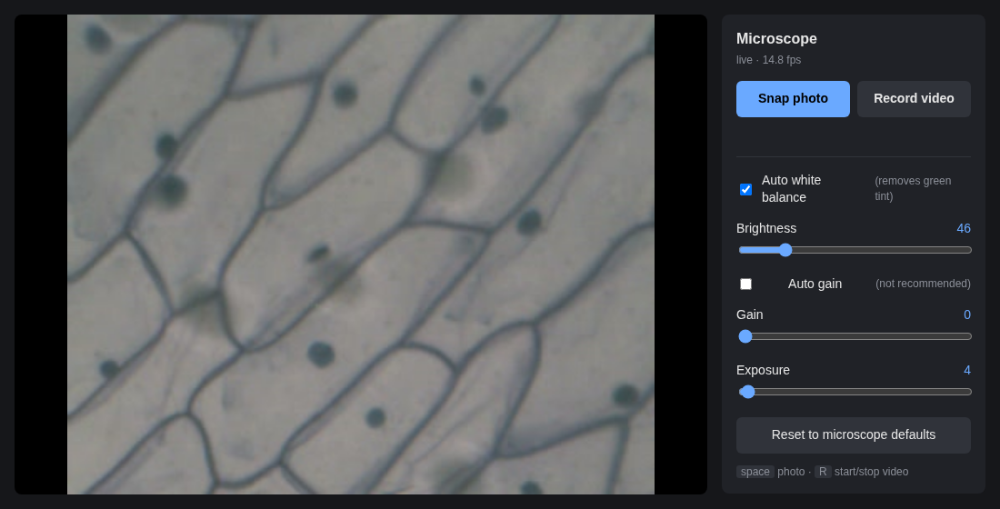

# pac207_microscope_viewer

A small browser viewer for cheap USB microscopes built on the **Pixart PAC207** chip
(USB ID `093a:2468`). Live picture, sliders for the camera settings, photo and video buttons.



## Why

These microscopes send video in a format called `P207` that browsers, OBS and most camera apps can't
read on Linux, so you get a black window or nothing. This script runs `ffmpeg` through libv4l's converter
(which understands `P207`), turns the frames into an ordinary MJPEG stream and serves it to a web page on
your own computer.

It also fixes two quirks of this camera:

- **Auto gain ruins the picture.** It turns gain and exposure all the way up and the image becomes dark
  noise. The viewer switches to working manual values (gain 0, exposure 4) whenever the camera is plugged in.
- **Green tint.** The sensor has no white balance. The *Auto white balance* box runs ffmpeg's `grayworld`
  filter to even out the colours. Your browser remembers this setting.

## Features

- Live view, auto-reconnects when you unplug and replug the camera
- Sliders for brightness, gain and exposure, plus an auto gain switch
- **Snap photo** (or press <kbd>space</kbd>): saves a JPEG to `~/Pictures/microscope/`
- **Record video** (or press <kbd>R</kbd>): saves an H.264 `.mp4` to `~/Videos/microscope/`, played back at real speed
- Frame rate display, with a warning when it drops (see *Tips*)
- Python standard library only

## Install

Needs Python 3.9+, `ffmpeg` 5.1+ and `v4l-utils` (for `v4l2-ctl` and libv4l).

```bash
# Arch
sudo pacman -S ffmpeg v4l-utils
# Debian / Ubuntu / Raspberry Pi OS
sudo apt install ffmpeg v4l-utils libv4l-0

git clone https://github.com/toldenburger/pac207_microscope_viewer
cd pac207_microscope_viewer
python3 microscope_viewer.py --open
```

Then open <http://127.0.0.1:8642> if the browser didn't open on its own.

| Option | Meaning |
|---|---|
| `--port 8642` | port for the page |
| `--device /dev/video2` | use this device instead of searching for the PAC207 |
| `--open` | open the page in your default browser |

Other webcams in odd formats may also work with `--device`; the camera settings shown are whatever the
device offers.

## Tips

- **Plug it straight into the computer.** Behind a USB hub the camera can drop to about 1 frame per second
  with green static (the kernel log says `Not enough bandwidth for altsetting`).
- **Reset to microscope defaults** brings back the working gain and exposure values if the picture goes dark.

## Safety

The server only listens on `127.0.0.1` (your own computer). It also refuses requests whose `Host` or
`Origin` header isn't that address, so a web page you visit can't change camera settings or start a
recording behind your back.

## License

MIT, see [LICENSE](LICENSE).

---

Made by Claude 🤖
